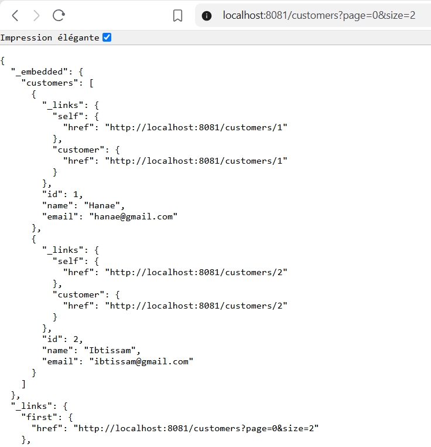
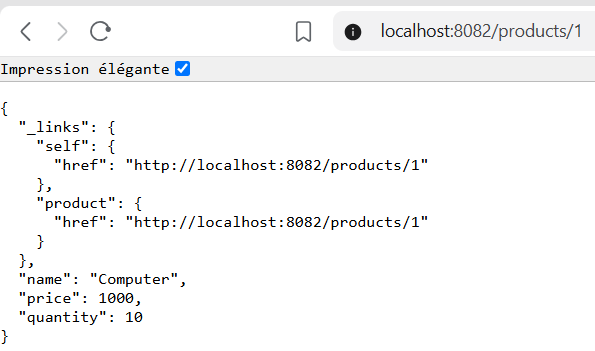
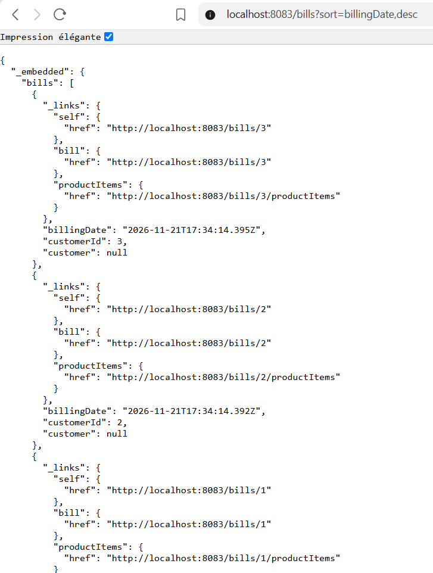
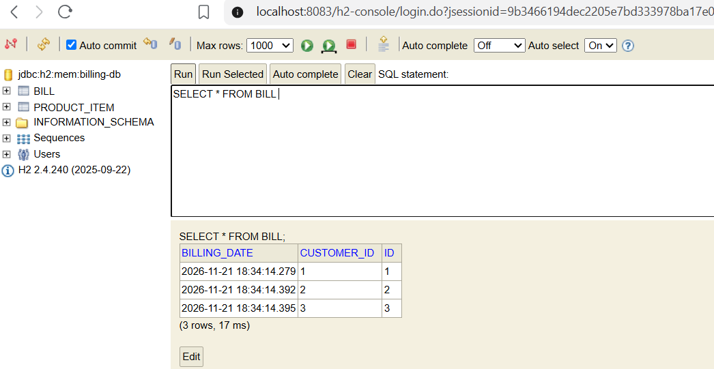
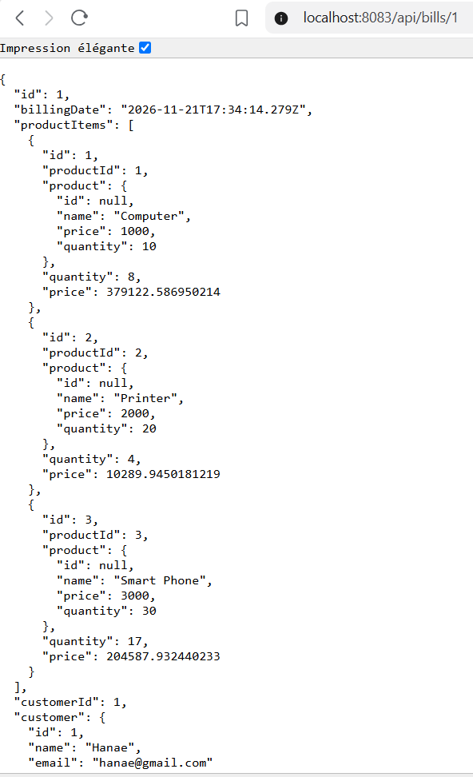
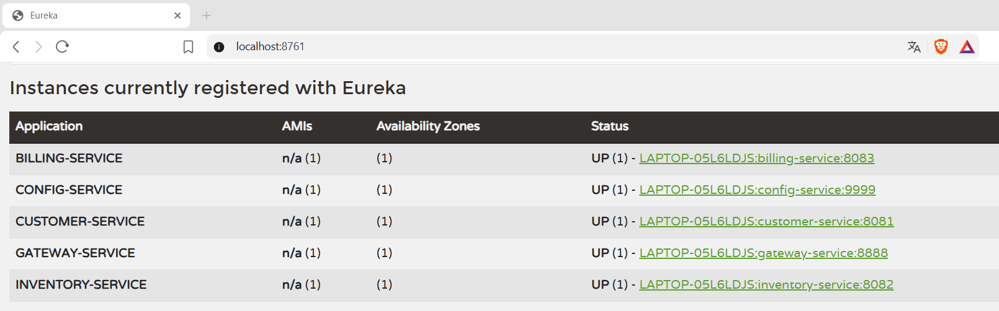
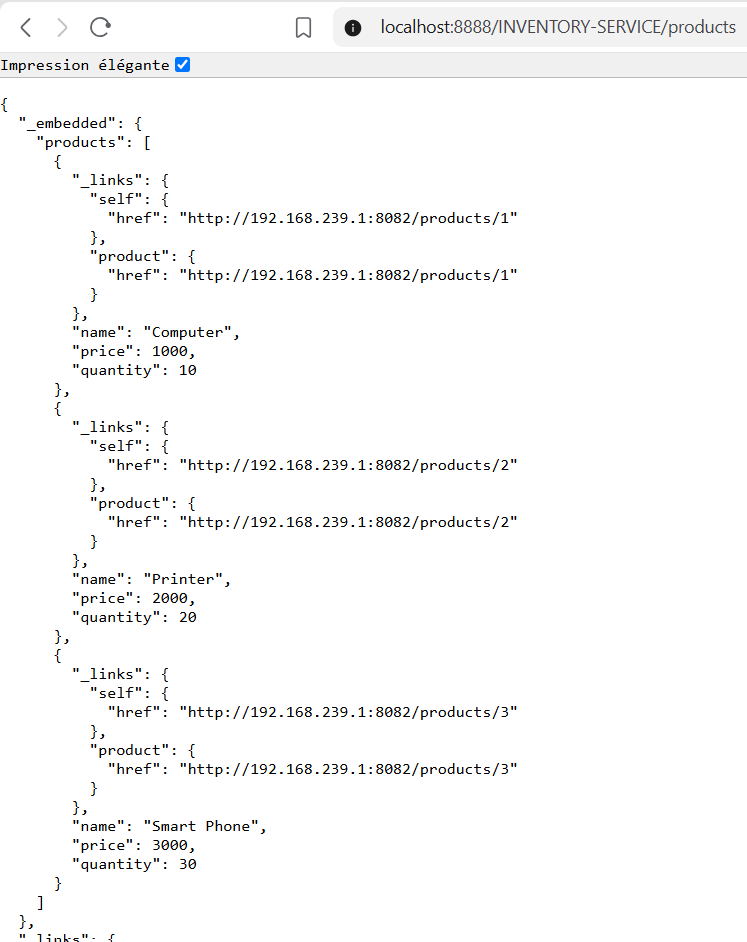
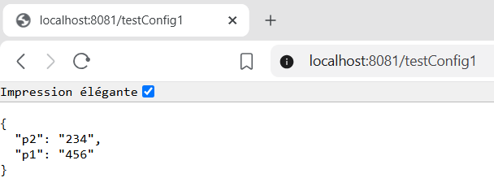
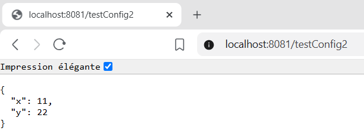

# TP2 JEE : Architecture micro-services e-commerce avec Spring Cloud

Application e-commerce basée sur une **architecture micro-services** (Spring Boot et Spring Cloud) : gestion des clients, des produits et des factures, avec un annuaire de services, une passerelle, une configuration centralisée, la communication entre services avec OpenFeign et la tolérance aux pannes avec Resilience4J.

Réalisé par **Hanae Bouichnad**, dans le cadre du module JEE.

---

## Architecture

```
                 Postman / Navigateur
                          |
                          v
              +-----------------------+
              |   GATEWAY-SERVICE     |  :8888   point d'entrée unique
              +-----------------------+
                 |        |         |
                 v        v         v
   +--------------+  +--------------+  +------------------+
   | CUSTOMER-    |  | INVENTORY-   |  | BILLING-         |
   | SERVICE      |  | SERVICE      |  | SERVICE          |
   | :8081        |  | :8082        |  | :8083            |
   | clients      |  | produits     |  | factures         |
   +--------------+  +--------------+  | OpenFeign +      |
          ^                 ^          | Circuit Breaker  |
          |                 |          +------------------+
          +-------- OpenFeign ---------------+
                                             
   +------------------------+     +------------------------+
   |  DISCOVERY-SERVICE     |     |  CONFIG-SERVICE        |
   |  :8761  annuaire       |     |  :9999  configuration  |
   |  Eureka                |     |  centralisée           |
   +------------------------+     +------------------------+
                                             |
                                             v
                                  dépôt GitHub configTP2JEE
```

| Service | Port | Rôle |
|---|---|---|
| **discovery-service** | 8761 | Annuaire Eureka : chaque service s'y inscrit avec son nom |
| **config-service** | 9999 | Serveur Spring Cloud Config : distribue la configuration lue sur GitHub |
| **customer-service** | 8081 | Gestion des clients, exposée avec Spring Data REST |
| **inventory-service** | 8082 | Gestion des produits, exposée avec Spring Data REST |
| **billing-service** | 8083 | Gestion des factures, appelle customer-service et inventory-service avec OpenFeign, Circuit Breaker Resilience4J |
| **gateway-service** | 8888 | Point d'entrée unique, routage dynamique à partir d'Eureka |

---

## Technologies

- **Java 17**, **Spring Boot 4**, **Spring Cloud**
- **Spring Data JPA**, **Spring Data REST**, **H2**, **Lombok**
- **Eureka** (Discovery Service), **Spring Cloud Gateway**
- **Spring Cloud Config** (configuration centralisée sur GitHub)
- **OpenFeign** (communication entre services), **Resilience4J** (Circuit Breaker)
- **Spring Boot Actuator** (endpoint `/actuator/refresh`)

---

## 1. Customer-Service

Les clients sont exposés automatiquement par **Spring Data REST** grâce à `@RepositoryRestResource`. La classe `RestRepositoryConfig` permet d'afficher l'`id` des clients dans les réponses JSON.

Tous les clients (`/customers`) :


Un client par son id (`/customers/1`) :


Pagination (`/customers?page=0&size=2`) :



Tri (`/customers?sort=name,desc`) :


Base de données H2 :


---

## 2. Inventory-Service

Les produits sont exposés de la même façon avec **Spring Data REST**.

Tous les produits (`/products`) :


Un produit par son id :



Pagination :


Tri :


Base de données H2 :


---

## 3. Billing-Service

Chaque micro-service a sa propre base de données. La base de billing-service ne stocke donc que les **identifiants** du client et des produits. Pour afficher une facture complète, billing-service appelle customer-service et inventory-service avec **OpenFeign**.

### Endpoints Spring Data REST

Ils lisent uniquement la base de billing-service : le champ `customer` reste à `null`.

Toutes les factures (`/bills`) :


Une facture par son id (`/bills/1`) :


Pagination :


Tri :



Base de données H2 :



Lignes de facture (`/productItems`) :


### Communication entre services avec OpenFeign

Le contrôleur `BillRestController` (`/api/bills/{id}`) récupère la facture, puis appelle customer-service et inventory-service pour remplir le client et les produits :



### Circuit Breaker (Resilience4J)

Quand customer-service est arrêté, billing-service ne plante pas : la méthode de secours (fallback) renvoie un client par défaut.


---

## 4. Discovery Service (Eureka)

Les services inscrits dans l'annuaire, avec leurs noms et leurs adresses :



---

## 5. Gateway

Les routes sont générées dynamiquement à partir d'Eureka : le nom du service est placé dans l'URL.

Customer-service via la Gateway (`/CUSTOMER-SERVICE/customers`) :


Inventory-service via la Gateway (`/INVENTORY-SERVICE/products`) :



Billing-service via la Gateway (`/BILLING-SERVICE/api/bills/1`) :


---

## 6. Configuration centralisée (Spring Cloud Config)

Les fichiers de configuration sont stockés dans un dépôt GitHub séparé : **[configTP2JEE](https://github.com/HanaeBouichnad/configTP2JEE)**.

| Fichier | Contenu |
|---|---|
| `application.properties` | Paramètres communs à tous les services (paramètres globaux, Eureka, Actuator, console H2) |
| `xxx-service.properties` | Paramètres propres à un service (profil par défaut) |
| `xxx-service-dev.properties` | Paramètres du profil `dev` |
| `xxx-service-prod.properties` | Paramètres du profil `prod` |

Paramètres globaux (`/application/default`) :


Paramètres de customer-service selon le profil :


Lecture des paramètres dans customer-service avec `@Value` :



Lecture des paramètres avec `@ConfigurationProperties` (record `CustomerConfigParams`) :



---

## Lancer le projet

### Ordre de démarrage

1. `discovery-service`
2. `config-service`
3. `customer-service`
4. `inventory-service`
5. `billing-service`
6. `gateway-service`

### URLs utiles

| URL | Description |
|---|---|
| http://localhost:8761 | Tableau de bord Eureka |
| http://localhost:9999/application/default | Configuration globale |
| http://localhost:8888/CUSTOMER-SERVICE/customers | Clients via la Gateway |
| http://localhost:8888/INVENTORY-SERVICE/products | Produits via la Gateway |
| http://localhost:8888/BILLING-SERVICE/api/bills/1 | Facture complète via la Gateway |